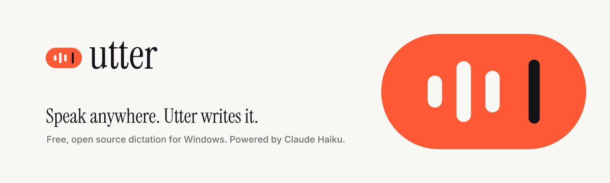
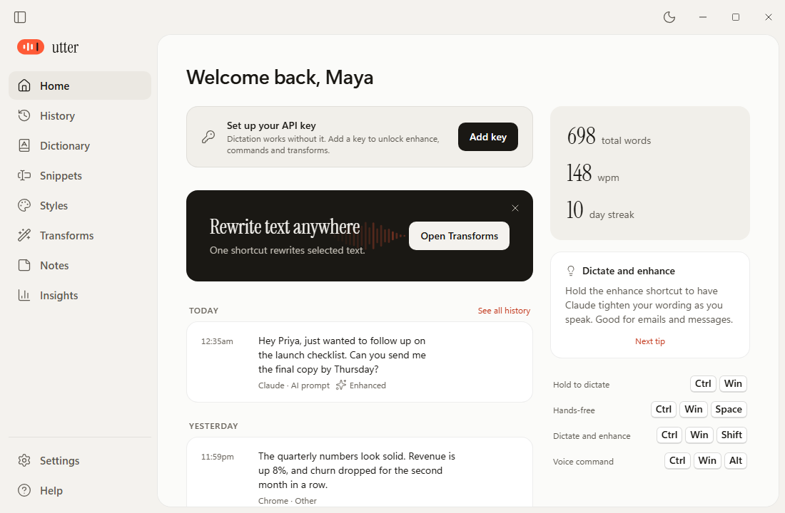
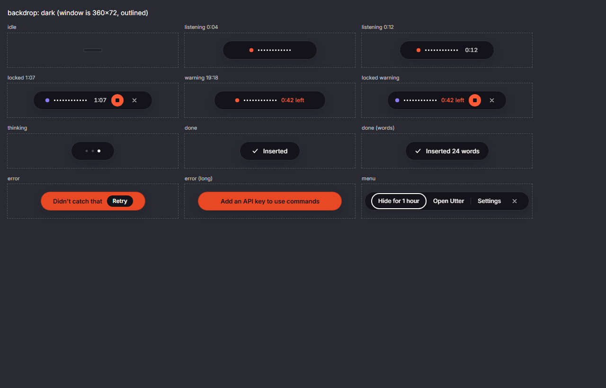
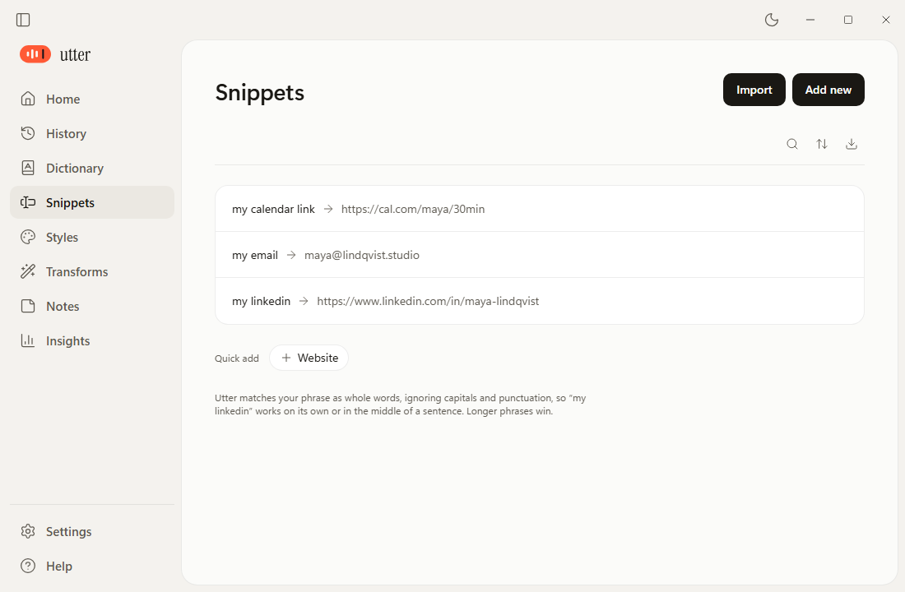
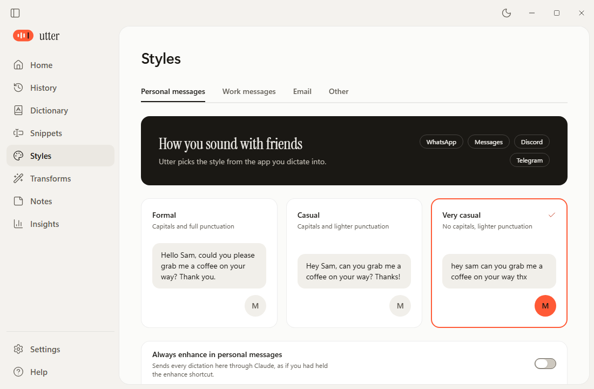
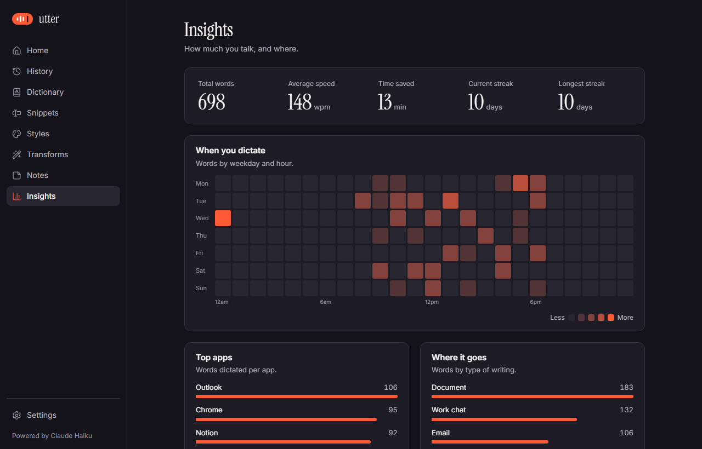
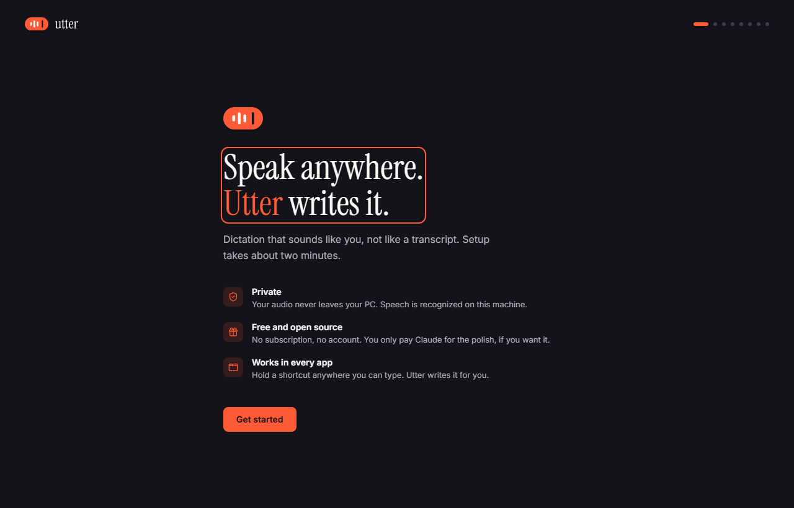

<p align="center">
  
</p>

# Utter

**Speak anywhere. Utter writes it.**

Utter is free, open source dictation for Windows. Hold **Ctrl+Win**, talk, let go. Clean text appears in whatever app you were typing in, about a second later.

Speech recognition runs on your PC with Whisper. Cleanup and rewriting use Claude Haiku through your own Anthropic API key. Audio never leaves your machine.

[Download](https://github.com/aadityamittal1/utter/releases) | [Connect Claude](#connect-claude) | [Shortcuts](#default-shortcuts) | [Build from source](docs/DEVELOPMENT.md)

## Features

- **Dictation**: hold the shortcut, speak, release. Text is inserted once, in the focused app. **Hands-free** mode locks recording on (double-tap the shortcut or press `Ctrl+Win+Space`); `Esc` cancels.
- **The pill**: a small floating bar that shows listening, thinking, done and error states with live level bars. It never takes focus and can be hidden.
- **AI cleanup**: three levels (Off, Light, Medium). Removes fillers, fixes punctuation and grammar, and handles **backtrack**: "coffee at 2, actually 3" becomes "Coffee at 3." Spoken punctuation and numbered lists work too.
- **Context-aware styles**: Utter notices the app you are in (email, work chat, personal chat, AI prompt, code, document) and applies a style per category: Formal, Casual, Very casual or Excited. Rules are editable.
- **Dictionary**: names and jargon are kept exactly, and you can add replacements ("clawed" becomes "Claude"). Edit a result in History and Utter suggests the words it should learn.
- **Snippets**: voice shortcuts. Say "my linkedin" and your URL appears. A snippet on its own is inserted instantly, with no AI call.
- **Dictate & enhance**: hold `Ctrl+Win+Shift` and Utter rewrites for the context: a structured email, a clear AI prompt, a polished chat message. Turn on **auto-enhance** for chosen categories.
- **Transforms**: select text, press a shortcut, the selection is replaced. Built in: **Polish** and **Prompt engineer**. Add up to 8 of your own.
- **Command mode**: hold `Ctrl+Win+Alt` and say "make this shorter", "translate to Spanish" or "write a reply saying I can do Thursday".
- **History**: every dictation, grouped by day. Copy, insert again, retry cleanup, compare with the original text (diff), play the audio, edit, delete, search. Undo is your app's own `Ctrl+Z`.
- **Notes**: a simple scratchpad (`Alt+Shift+N`).
- **Insights**: words, speaking speed, time saved, streaks, an activity heatmap, and top apps.
- **Onboarding**: connect Claude, pick a microphone, download a speech model, learn the shortcut and try it, in a few minutes.
- **Tray**: open Utter, start dictation, paste last, pause for an hour, quit. Light, dark or system theme, launch at login, about 99 languages.

## Screenshots

| | |
|---|---|
|  |  |
|  |  |
|  |  |

## Install

1. Download the latest installer for your PC from [Releases](https://github.com/aadityamittal1/utter/releases): x64 or ARM64.
2. Run it. The installer is **not code-signed yet** (v1), so Windows SmartScreen may say "Windows protected your PC". Click **More info**, then **Run anyway**. Some antivirus tools also flag keyboard hooks and simulated paste in unsigned apps; Utter needs both to work.
3. Follow the first-run steps.

**Requirements:** Windows 10 or 11, x64 or ARM64. About 150 to 600 MB of disk for the speech model you pick.

## Connect Claude

Utter uses **your own Anthropic API key**. Claude.ai and Claude Code subscriptions can't be used by third-party apps, so a key from the Anthropic Console is required for AI cleanup.

1. Create a key at <https://console.anthropic.com/settings/keys>.
2. Paste it in onboarding or **Settings, AI**, and press Test.
3. Your key is stored in **Windows Credential Manager**, never in a settings file or log.

**Cost.** Claude Haiku 5.5 costs $0.10 / $0.50 per million input / output tokens. A typical dictation costs about **$0.0003**, roughly **3,000 dictations per dollar**. Settings, AI shows a monthly estimate.

No key? Utter still works: it uses local rules for cleanup. Command mode, Dictate & enhance and Transforms need a key. If Claude is unreachable, Utter falls back to local cleanup, so a dictation is never lost.

## Default shortcuts

| Action | Shortcut |
|---|---|
| Dictate | Hold `Ctrl+Win` |
| Hands-free | `Ctrl+Win+Space` (toggle), or double-tap Dictate within 400 ms |
| Dictate & enhance | Hold `Ctrl+Win+Shift` |
| Command mode | Hold `Ctrl+Win+Alt` |
| Cancel | `Esc` (while recording) |
| Paste last | `Alt+Shift+Z` |
| Copy last | `Alt+Shift+C` |
| Polish selection | `Alt+Shift+1` |
| Prompt engineer selection | `Alt+Shift+2` |
| Quick note | `Alt+Shift+N` |

Every shortcut can be rebound in Settings, Shortcuts. Recordings under 0.4 seconds are discarded; the maximum is 20 minutes.

## Privacy

- **Audio never leaves your PC.** Speech recognition is local.
- Only **text** goes to Claude, and only if you added a key. The foreground app name is included as context (you can turn that off). No screenshots, no reading other fields.
- **No telemetry, no analytics, no accounts.**
- History retention is yours to choose: forever, 24 hours, or never. Keeping audio (14 days) is optional.

Details: [docs/PRIVACY.md](docs/PRIVACY.md).

## Build from source

See [docs/DEVELOPMENT.md](docs/DEVELOPMENT.md) (prerequisites, ARM64 notes, long-path workaround) and [docs/ARCHITECTURE.md](docs/ARCHITECTURE.md). Short version:

```
cd apps/desktop
npm install
npm run tauri dev
```

## Roadmap

- macOS
- Code signing (to remove the SmartScreen warning)
- Auto-updater
- GPU (Vulkan) acceleration for speech recognition
- More languages in the UI

Ideas and bugs are welcome: see [CONTRIBUTING.md](CONTRIBUTING.md).

## Credits

- Speech recognition: [whisper.cpp](https://github.com/ggml-org/whisper.cpp) (MIT) via whisper-rs
- App framework: [Tauri](https://tauri.app)
- AI cleanup: Claude Haiku via your own Anthropic API key
- Fonts: Inter, Instrument Serif, JetBrains Mono (open licenses)

## License

[MIT](LICENSE)
