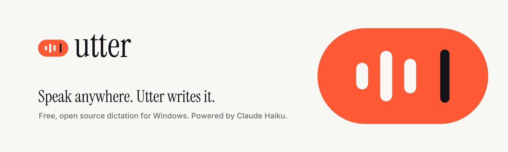
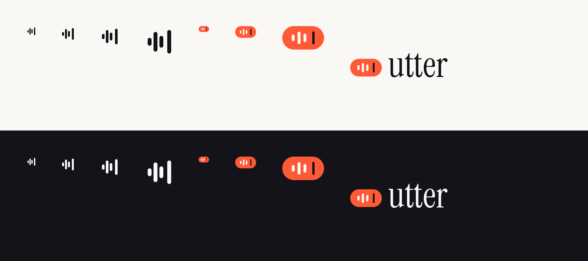

# Utter brand guide

Utter is a free, open source dictation app for Windows. You hold a key, speak, and clean text appears wherever your cursor is.



## Name and tagline

- Name: **Utter** (capital U in prose, `utter` lowercase only in the wordmark). Product name `Utter`, identifier `dev.utter.desktop`.
- Tagline: **Speak anywhere. Utter writes it.** Use it verbatim, with both full stops.
- Descriptor: "Free, open source dictation for Windows."
- Attribution: where the AI step needs crediting, write exactly **Powered by Claude Haiku**. Nothing more. Utter never uses another company's logo, colours or phrasing, and says nothing about being affiliated with anyone.

## Voice

Friendly, plain, confident.

- Short sentences. Say what happens: "Hold Ctrl+Win, talk, let go."
- Say "you" and "your PC". Skip hype words (seamless, supercharge, next-gen).
- Be honest about limits: "Audio stays on your PC. Only the text goes to Claude, and only if you add a key."
- Errors say what to do next: "Add an API key to use commands."

## Mark

A rounded pill. On the left, three sound bars. On the right, a text caret. Voice becoming text.

| Piece | Colour |
| --- | --- |
| Pill | Ember `#FF5A36` |
| Bars | Paper `#FAF8F5` |
| Caret | Ink `#14131A` |

Geometry (128 x 72 box): pill radius 36; bars 9 wide at x 29, 47, 65 and 20, 38, 26 tall; caret 7 wide, 40 tall at x 92. The caret gap is twice the bar gap, so the caret always reads as the next thing to be typed.

Files in `logo/`:

| File | Use |
| --- | --- |
| `mark.svg` | Full-colour mark. Works on light and dark backgrounds. |
| `mark-mono.svg` | One colour (Ink) with bars and caret knocked out. Recolour the fill for print, embossing, single-colour contexts. |
| `wordmark.svg`, `wordmark-dark.svg` | "utter" outlines in Ink / Paper. |
| `lockup.svg`, `lockup-dark.svg` | Mark + wordmark. |

At 16 px the pill is dropped and only the bars and caret are used (see tray icons). Do not shrink the full pill mark below 24 px wide.

### Clear space and minimum size

- Clear space: the height of the pill's caret (about 0.55 of the mark height) on every side.
- Minimum size: mark 24 px wide (digital), lockup 96 px wide. Below that use the bars-and-caret glyph.

### Don'ts

- Do not recolour the pill, swap bar and caret colours, or add outlines, shadows or gradients.
- Do not rotate, skew, stretch, or change bar count.
- Do not set the wordmark in another typeface or add the caret to it.
- Do not place the mark on Ember or on busy photos. Use Ink or Paper behind it.
- Do not combine the mark with another company's logo as if it were one lockup.

## Palette

| Name | Hex | Role |
| --- | --- | --- |
| Ink | `#14131A` | App icon and tray glyph (brand assets) |
| Paper | `#FAF8F5` | Text on Ink in brand assets |
| Ember | `#FF5A36` | The brand accent: the logo mark, live states, selection, links, chart data |

The app UI uses a warm neutral ramp so it sits quietly beside every Windows app, with Ember as the only accent. Primary buttons and "on" switches are ink, not Ember. Users can switch the accent to their Windows accent colour in Settings.

| Token | Light | Dark |
| --- | --- | --- |
| canvas (window background) | `#F4F2EE` | `#1B1A19` |
| panel (content surface) | `#FBFBF9` | `#232220` |
| card | `#FFFFFF` | `#2A2826` |
| raised (grouped settings, active rows) | `#F1EFEA` | `#312F2C` |
| text | `#1A1814` | `#F4F2EE` |
| secondary text | `#5E5A52` | `#C4BFB6` |
| muted text | `#6C675F` | `#A39D93` |
| hairline | text at 8% | text at 8% |
| primary button | `#1A1814`, white label | `#F4F2EE`, ink label |
| ember as text | `#C2361A` | `#FF8A6E` |

All text roles reach 4.5:1 on their surfaces. Ink text on Ember fill is about 5.8:1, so Ember fills use ink labels. Rule: one accent per screen; Ember marks what is live, selected or important, never decoration.

## Type

| Role | Family | Notes |
| --- | --- | --- |
| UI | Segoe UI Variable (Text / Display) | The Windows 11 system font; 400 and 600. Not bundled. |
| Display serif | Instrument Serif | Banner headlines, settings section titles, big stat figures. Bundled via `@fontsource` (SIL OFL 1.1). |
| Code and shortcuts | Cascadia Mono, then Consolas | Keycaps and code, from the system. |

The wordmark is outlines derived from Instrument Serif Regular (via `opentype.js`), so no font is needed to display it.

Type ramp follows Windows 11 (px / line height, sizes in rem so the Windows text size setting scales them): caption 12/16, body 14/20, body strong 14/20 semibold, body large 18/24, subtitle 20/28, title 28/36, title large 40/52, display 68/92. Small group labels may be uppercase 12 px with 0.06em tracking; nothing else is uppercase. Serif text is never bold or faux-italic.

Shape and motion follow Fluent: controls 10 px radius, cards 16, the content panel 20; one easing curve `cubic-bezier(0, 0, 0, 1)` at 83 / 167 / 250 / 333 ms.

## App icon

Ink rounded square (radius 22.7%) holding the full pill mark at about 83% width. Master: `icon/icon-1024.png` (source `icon/icon.svg`); `icon/icon-{512,256,128,64,32,16}.png` are straight renders. Installer, Store and `.ico`/`.icns` assets in `apps/desktop/src-tauri/icons/` are generated from the master with `npx tauri icon`.

## Tray icons

Pill-less glyph on a 16 px grid: three 2 px bars with 1 px gaps and a 2 px caret. Pixel-aligned at 16 and 32 px; 24 px is a 1.5x scale.

| State | Light taskbar | Dark taskbar | Meaning |
| --- | --- | --- | --- |
| Idle | `tray-idle-*` (Ink) | `tray-idle-dark-*` (Paper) | Ready |
| Recording | `tray-recording-*` (Ember, caret becomes a dot) | same | Listening |
| Paused | `tray-paused-*` (grey) | `tray-paused-dark-*` | Shortcuts off |

Each state exists at 16, 24, 32 px and `@2x` (32, 48, 64 px). Pick the "light" or "dark" set from the Windows system theme.

## Pill (the on-screen recorder)

A small capsule pinned bottom-centre, 12 px above the taskbar, on the monitor under the cursor. Always on top, never focused. Same colours in both themes, because it floats over arbitrary content.

| State | Size (px) | Content |
| --- | --- | --- |
| Idle | 44 x 8 | Solid ink bar with a light hairline, readable on any wallpaper |
| Idle, hovered | 196 x 32 | Dictate shortcut as keycaps + "to dictate"; click starts hands-free |
| Listening | 148 x 36 | Ember live dot, 9-bar white waveform (2 px bars, 3 px gaps, 4 to 20 px tall), timer from 10 s |
| Hands-free | 212 x 36 | Adds an Ember stop button and cancel |
| Thinking | 72 x 36 | Three slow dots |
| Done | 212 x 36 | Check + "Inserted" (or "Copied") |
| Error | 280 x 36 | Danger tint, message, Retry when possible |

- Surface: ink `#1A1814` with a `rgb(255 255 255 / 0.18)` hairline. Warning at 19 minutes uses caution yellow `#FCE100`.
- Motion: grows on `cubic-bezier(0, 0, 0, 1)`, shrinks on `cubic-bezier(1, 0, 1, 1)`, 167 ms; the waveform eases with fast attack, slow release. Reduced motion shows a static level meter.

## Sounds

Generated by `scripts/make-sounds.mjs` (original, 16-bit 44.1 kHz mono, peak -12 dBFS, 5 ms fades): `start.wav` soft two-tone rise (~120 ms), `stop.wav` single soft pop (~90 ms), `error.wav` low double blip (~200 ms).

## Social images

`social/social-preview.png` (1280 x 640, GitHub social preview) and `social/readme-banner.png` (1600 x 480). Previews:




## Regenerating

```sh
cd brand
npm ci
npm run render          # SVGs, icon PNGs, tray PNGs, social images
cd ../apps/desktop
npx tauri icon ../../brand/icon/icon-1024.png   # installer icons
cd ../.. && node scripts/make-sounds.mjs         # UI sounds
```
