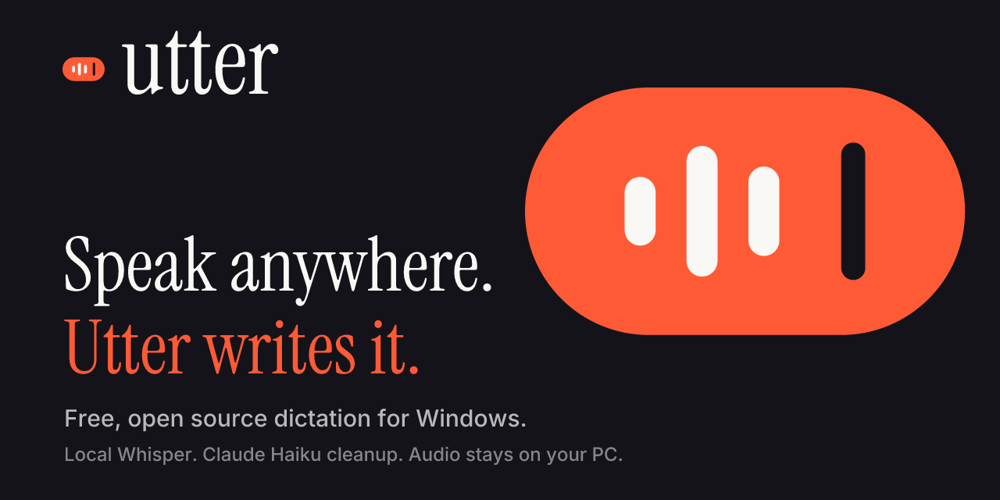

# Utter brand guide

Utter is a free, open source dictation app for Windows. You hold a key, speak, and clean text appears wherever your cursor is.


## Name and tagline

- Name: **Utter** (capital U in prose, `utter` lowercase only in the wordmark). Product name `Utter`, identifier `dev.utter.app`.
- Tagline: **Speak anywhere. Utter writes it.** Use it verbatim, with both full stops.
- Descriptor: "Free, open source dictation for Windows."
- Attribution: where the AI step needs crediting, write exactly **Powered by Claude Haiku**. Nothing more. Utter never uses another company's logo, colours or phrasing, and says nothing about being affiliated with anyone.

## Voice

Friendly, plain, confident.

- Short sentences. Say what happens: "Hold Ctrl+Win, talk, let go."
- Say "you" and "your PC". Skip hype words (seamless, supercharge, next-gen).
- Be honest about limits: "Audio stays on your PC. Only the text goes to Claude, and only if you add a key."
- Errors say what to do next: "Add an API key to use commands."

## Mark

A rounded pill. On the left, three sound bars. On the right, a text caret. Voice becoming text.

| Piece | Colour |
| --- | --- |
| Pill | Ember `#FF5A36` |
| Bars | Paper `#FAF8F5` |
| Caret | Ink `#14131A` |

Geometry (128 x 72 box): pill radius 36; bars 9 wide at x 29, 47, 65 and 20, 38, 26 tall; caret 7 wide, 40 tall at x 92. The caret gap is twice the bar gap, so the caret always reads as the next thing to be typed.

Files in `logo/`:

| File | Use |
| --- | --- |
| `mark.svg` | Full-colour mark. Works on light and dark backgrounds. |
| `mark-mono.svg` | One colour (Ink) with bars and caret knocked out. Recolour the fill for print, embossing, single-colour contexts. |
| `wordmark.svg`, `wordmark-dark.svg` | "utter" outlines in Ink / Paper. |
| `lockup.svg`, `lockup-dark.svg` | Mark + wordmark. |

At 16 px the pill is dropped and only the bars and caret are used (see tray icons). Do not shrink the full pill mark below 24 px wide.

### Clear space and minimum size

- Clear space: the height of the pill's caret (about 0.55 of the mark height) on every side.
- Minimum size: mark 24 px wide (digital), lockup 96 px wide. Below that use the bars-and-caret glyph.

### Don'ts

- Do not recolour the pill, swap bar and caret colours, or add outlines, shadows or gradients.
- Do not rotate, skew, stretch, or change bar count.
- Do not set the wordmark in another typeface or add the caret to it.
- Do not place the mark on Ember or on busy photos. Use Ink or Paper behind it.
- Do not combine the mark with another company's logo as if it were one lockup.

## Palette

| Name | Hex | Role |
| --- | --- | --- |
| Ink | `#14131A` | Text on light, dark-mode background |
| Paper | `#FAF8F5` | Light-mode background, text on dark |
| Ember | `#FF5A36` | Brand fill, primary buttons, recording |
| Ember dark | `#E0401E` | Ember text and links on light, pressed state |
| Lilac | `#8B7CF6` | Rare secondary accent: selection, highlights |

Warm neutrals (50 to 900) are in `palette.json`. Ink text on Ember passes 6:1; Paper text on Ember does not pass AA for body text, so Ember buttons use Ink labels.

Semantic tokens (full set in `palette.json`):

| Token | Light | Dark |
| --- | --- | --- |
| bg | `#FAF8F5` | `#14131A` |
| surface | `#FFFFFF` | `#1D1C25` |
| border | `#E4E0D9` | `#34323F` |
| text | `#14131A` | `#FAF8F5` |
| textMuted | `#5E5B66` | `#B4B1BC` |
| accent (text) | `#E0401E` | `#FF5A36` |
| highlight | `#8B7CF6` | `#A99EFA` |

Rule: one accent per screen. Ember is the accent; Lilac is a garnish, never a second button colour.

## Type

| Role | Family | Notes |
| --- | --- | --- |
| UI | Inter | 400 / 500 / 600 |
| Display | Instrument Serif | Headlines and the wordmark. Marketing and onboarding only, not dense UI. |
| Code and shortcuts | JetBrains Mono | Keys, paths, snippets |

All three are bundled offline via `@fontsource`. Inter, Instrument Serif and JetBrains Mono are licensed under the SIL Open Font License 1.1. The wordmark is outlines derived from Instrument Serif Regular (via `opentype.js`), so no font is needed to display it.

Scale (px / line height): caption 12/16, small 13/18, body 14/20, large 16/24, title 20/28, heading 28/34 (serif), display 48/52 (serif). Serif display uses tight tracking (-0.01em) and is never bold or faux-italic.

## App icon

Ink rounded square (radius 22.7%) holding the full pill mark at about 83% width. Master: `icon/icon-1024.png` (source `icon/icon.svg`); `icon/icon-{512,256,128,64,32,16}.png` are straight renders. Installer, Store and `.ico`/`.icns` assets in `apps/desktop/src-tauri/icons/` are generated from the master with `npx tauri icon`.

## Tray icons

Pill-less glyph on a 16 px grid: three 2 px bars with 1 px gaps and a 2 px caret. Pixel-aligned at 16 and 32 px; 24 px is a 1.5x scale.

| State | Light taskbar | Dark taskbar | Meaning |
| --- | --- | --- | --- |
| Idle | `tray-idle-*` (Ink) | `tray-idle-dark-*` (Paper) | Ready |
| Recording | `tray-recording-*` (Ember, caret becomes a dot) | same | Listening |
| Paused | `tray-paused-*` (grey) | `tray-paused-dark-*` | Shortcuts off |

Each state exists at 16, 24, 32 px and `@2x` (32, 48, 64 px). Pick the "light" or "dark" set from the Windows system theme.

## Pill (the on-screen recorder)

A small floating capsule at the bottom centre of the screen.

- Shape: full radius, 44 px tall, 20 px side padding, 12 px gap between elements.
- Surface: Ink at 92% with a 1 px `#34323F` border, in both themes (it floats over arbitrary content).
- Listening: 12 Ember bars (3 px wide, rounded) driven by mic level, plus elapsed time in Inter 500, Paper.
- Locked (hands-free): bars plus a Lilac lock dot; click or the toggle shortcut stops.
- Thinking: bars settle into three slow Ember pulses.
- Done: the caret from the mark blinks once in Paper, then the pill fades in 200 ms.
- Error: Ember dark border, message in Paper ("Didn't catch that", "Add an API key to use commands").
- Motion: ease-out, 120 to 200 ms; reduced-motion shows static bars.

## Sounds

Generated by `scripts/make-sounds.mjs` (original, 16-bit 44.1 kHz mono, peak -12 dBFS, 5 ms fades): `start.wav` soft two-tone rise (~120 ms), `stop.wav` single soft pop (~90 ms), `error.wav` low double blip (~200 ms).

## Social images

`social/social-preview.png` (1280 x 640, GitHub social preview) and `social/readme-banner.png` (1600 x 480). Previews:




## Regenerating

```sh
cd brand
npm ci
npm run render          # SVGs, icon PNGs, tray PNGs, social images
cd ../apps/desktop
npx tauri icon ../../brand/icon/icon-1024.png   # installer icons
cd ../.. && node scripts/make-sounds.mjs         # UI sounds
```
