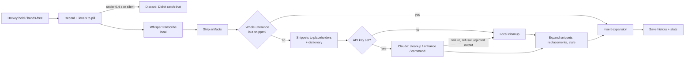

# Architecture

Utter is a Tauri v2 app: a Rust core (`apps/desktop/src-tauri`) and a React + TypeScript UI (`apps/desktop/src`) in two webview windows, the hub and the pill.

## Module map

### Rust core (`apps/desktop/src-tauri/src`)

| Module | Responsibility |
|---|---|
| `lib.rs`, `main.rs`, `app_state.rs` | App setup, plugins, shared state |
| `commands.rs` | Tauri commands (the IPC surface) |
| `tray.rs`, `windows.rs` | Tray menu; hub and pill window creation |
| `hotkeys/` | Global low-level keyboard hook (`hook_windows`), chord parsing (`chord`), and the matcher (`matcher`) for hold, double-tap and chord collisions. Pure matcher is unit-tested |
| `audio/` | `cpal` capture, resample to 16 kHz mono, pre-roll buffer, RMS levels for the pill, gain normalization (`dsp`), WAV writing |
| `stt/` | whisper.cpp engine wrapper (`engine`), model catalog (`catalog`), resumable verified downloads (`download`) |
| `text/` | Pure text logic: local cleanup rules, spoken punctuation, backtrack, snippets, dictionary replacements, styles, artifact stripping (`[BLANK_AUDIO]`) |
| `context/` | Foreground app capture (`foreground_windows`) and category classifier (`classify`, pure) |
| `llm/` | Anthropic client (`client`), prompt builders (`prompts`), output extraction and validation (`output`) |
| `insert/` | Clipboard save/restore (`clipboard_windows`), key simulation (`keys_windows`), insertion policy such as terminals and modifier release (`policy`) |
| `pipeline/` | Session state machine (`session`) and routing decisions (`route`): what to do with a finished recording |
| `store/` | SQLite: history, dictionary, snippets, transforms, notes, usage, insights |
| `settings.rs`, `secrets.rs`, `sounds.rs` | JSON settings; API key in Windows Credential Manager via `keyring`; start/stop sounds |

Windows-specific code lives in `*_windows.rs` files behind platform-neutral functions, so macOS can be added later.

### UI (`apps/desktop/src`)

| Path | Responsibility |
|---|---|
| `lib/ipc.ts`, `lib/mock.ts` | Typed `invoke`/`listen` wrapper. Outside Tauri (plain browser, tests) it uses an in-memory mock backend |
| `lib/types.ts` | TypeScript mirrors of the Rust IPC types |
| `lib/store.ts` | Zustand store |
| `pages/` | Hub pages: Home, History, Dictionary, Snippets, Styles, Transforms, Notes, Insights, Settings |
| `pill/` | The floating pill (`pill.html`, its own entry) |
| `onboarding/` | First-run steps |
| `components/ui/`, `styles/` | Design-system components and brand tokens |

## Dictation pipeline

`Idle, Recording(mode), Transcribing, pre-pass, Claude, post-pass, Insert, Save, Idle`. Every stage emits `pill://state` events. Claude output is validated before use (`accept_ai_output`): answers instead of cleaned text, preambles, quotes and missing snippet placeholders are rejected and the local result is used instead.

Modes: `dictate`, `dictateEnhance`, `command`, `transform` (on selected text, captured with a simulated copy and the clipboard restored).

## IPC contract (summary)

All Rust types use `serde(rename_all = "camelCase")`; TS mirrors are in `lib/types.ts`.

- **Commands** (`invoke`): settings (`get_settings`, `update_settings`, `reset_shortcuts`), API key (`api_key_status`, `set_api_key`, `clear_api_key`, `test_api_key`), models (`list_models`, `download_model`, `cancel_download`, `delete_model`, `set_active_model`), audio (`list_microphones`, `start_mic_test`, `stop_mic_test`), shortcut capture, history (`history_*`), `dictionary_*`, `snippets_*`, `transforms_*`, `notes_*`, `insights_get`, `usage_get`, `pill_action`, `complete_onboarding`, `app_info`.
- **Events** (`listen`): `pill://state`, `pill://levels`, `mic://level`, `model://progress`, `shortcut://captured`, `history://changed`, `settings://changed`, `hub://navigate`.

The authoritative list is `commands.rs` and `lib/types.ts`.

## Threading model

- **Hook thread**: the low-level keyboard hook runs on a dedicated thread with its own message loop and does almost nothing: it feeds key events to the matcher and posts actions to the session. Injected keys (our own paste) are ignored to avoid feedback loops, and the hook must never block.
- **Audio thread**: the `cpal` stream callback pushes samples into a ring buffer; a consumer computes levels and accumulates the recording.
- **Session worker**: one dictation at a time. Transcription (CPU-heavy whisper) and the Claude request run off the UI and hook threads.
- **Async runtime**: network (Claude, model downloads) via async `reqwest`.
- **Insertion**: paste is serialized; the clipboard restore runs later on a background thread and is skipped if the clipboard changed meanwhile.
- **UI**: Tauri's main thread owns windows; commands are called from the webviews and events pushed to them.

## Privacy boundaries

- Audio exists only in memory and (optionally) as local WAV files. No code path sends it over the network.
- The only outbound requests: Claude (`api.anthropic.com`, text only, key from Credential Manager), model download, and key validation. No telemetry.
- The API key is read from the Credential Manager at request time and never enters settings, logs, errors, history or IPC responses (only `{set, last4}`).
- Any Claude failure degrades to local cleanup.

See [PRIVACY.md](PRIVACY.md) for the user-facing version.
